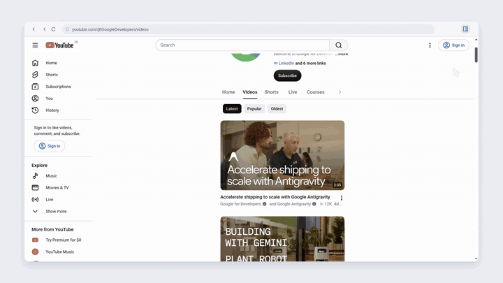

# YFE — YouTube Focus Extension

YFE is a free, open-source UnTrap alternative for Chrome: hide Shorts, recommendations and comments, filter unwanted content, and set focus sessions. Customize the YouTube interface from a persistent side panel, with 297 appearance and behavior settings.

English by default, with Russian available in settings. Local storage. No account, subscription, analytics or backend.

## Features

- **Distraction control:** hide YouTube Shorts, home recommendations, related videos, comments, live chat, topic chips and promotional shelves.
- **Appearance:** customize the home feed, search, subscriptions, channels, video cards, watch page, navigation, embedded player, colors and installed fonts.
- **Focus sessions:** start a session from the panel or YouTube, choose its duration and idle timeout, and track it with a live timer. Entry pauses, confirmation phrases, breaks, temporary blocking and weekly schedules are included.
- **Presets:** save layouts, select one when starting a session, or switch presets on a schedule. Applying a built-in preset requires confirmation and saves the previous appearance for restoration.
- **Content filters:** hide matching channels, video cards, comments and posts using text, IDs, links or a bounded regular-expression syntax. Add rules from YouTube menus.
- **Settings protection:** require a password or phrase for selected changes, with a single-use or five-minute confirmation.
- **Player controls:** default playback speed (0.25–4×), automatic fullscreen, preferred quality, native controls, autoplay prevention and automatic next-video control. Ad skipping and seeking are experimental.
- **Channel Play all:** an optional button on a channel's Videos tab opens its regular-video uploads playlist, newest first, without collecting loaded cards. Shorts and live streams are excluded.
- **One settings interface:** global search across every section, English/Russian switching, SVG navigation, JSON import/export, side panel by default and an optional full settings tab.

## Install in Chrome or Chromium

Chrome/Chromium 120+. No build step. Not yet available in the Chrome Web Store.

1. Download **`yfe-0.7.0-chrome.zip`** from the [latest release](https://github.com/DefaultPerson/youtube-focus-extension/releases/latest) and extract it.
2. Open `chrome://extensions` and enable **Developer mode**.
3. Choose **Load unpacked** and select the extracted folder containing **`manifest.json`**.
4. Reload YouTube and click the extension icon for the side panel; **↗** opens the current section in a full tab.

From source, load **`extension/`**. Appearance saves immediately; other forms use **Save**. Controls start neutral, and presets share filters and restrictions. An optional toggle shortcut is available at `chrome://extensions/shortcuts`.

## Privacy and permissions

Uses `storage`, `alarms` and `sidePanel`, with access limited to YouTube and its privacy-enhanced embeds. Page content, activity and settings are processed locally; nothing is sent to the developer. Optional thumbnail replacement requests images from YouTube. No accounts, analytics or remote code. [Full privacy policy](https://defaultperson.github.io/youtube-focus-extension/privacy.html).

## Limits

- YouTube markup changes; not every setting combination, layout or language is verified. Ad skipping is experimental and cannot remove every ad.
- Session limits are per session. Protection can be bypassed by uninstalling YFE or editing browser data. Filters hide cards/comments, not the currently playing video.

Other limits

- Regex rules support groups, alternation and `*`, `+`, `?` with bounded matching; lookarounds, backreferences and `{m,n}` are unsupported.
- Automatic fullscreen may need a Play gesture from Chrome and permission from the embedding site. It stays off after you exit for the current video.
- No mobile YouTube, summaries, translation or cloud sync.
- No artificial preset/rule quota; Chrome storage limits apply. JSON imports: 10 MB maximum.

## Development

Plain JavaScript/CSS and Manifest V3; no runtime dependencies. Run `python3 scripts/build-runtime.py` after changing the catalog, translations or runtime code; `--check` verifies the generated page data. `python3 scripts/package.py` checks freshness and creates a deterministic Chrome ZIP with integrity and source-byte checks. Reload YFE and YouTube after changes; check navigation and turning controls back off. [Verification and limits](docs/verification.md).

## Contributing

Bug reports should include your Chrome version, the YouTube page type, the setting involved, and steps to reproduce. Remove account names, private channel lists and personal settings before attaching screenshots or exports.

## License

MIT. This is an independent project and is not affiliated with or endorsed by UnTrap, YouTube or Google.
